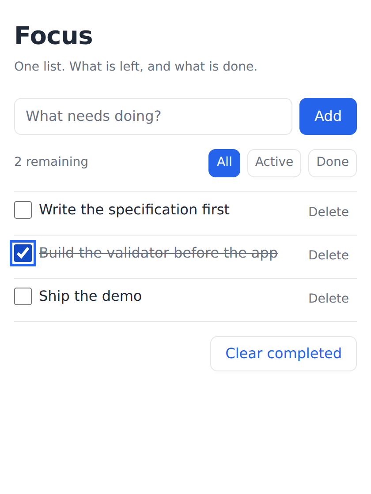

# Example: an autonomous build, start to finish

**A real run of the kit's D32 auditor + worker pipeline, captured whole.** One
auditor session decomposed a locked spec, dispatched four worker sessions across
two waves, verified what came back, integrated it, and parked on two questions
only a human could answer. Nothing here is reconstructed or idealised — the
transcript is what actually happened, including the parts that went wrong.

The product is **Focus**, a zero-dependency todo app. The product is not the
point; the run is.



---

## Why this exists

Before this run, `HANDOVER.md` said of D32:

> *Still untested by reality: D32's design rests on assumptions about how worker
> sessions behave that only a real unattended run can check.*

This is that check. It found three defects in the kit and one in the spec it was
building, which is roughly what a first real run should find. If it had come
back clean, that would have been evidence the run was too easy, not that the
design was right.

---

## What is in here

| Path | What it is |
|---|---|
| `README.md` | This walkthrough |
| `TRANSCRIPT.md` | Every prompt sent to a worker and every report sent back, verbatim |
| `RUN-DIGEST.md` | The auditor's end-of-run report: what was built, every T1 decision, open escalations |
| `SPEC.md` | The todo app's specification — the source the whole run was generated from |
| `TOOLING-AUDIT.md` | The D33 gate's record for this project |
| `index.html`, `src/`, `tests/` | The finished app: 7 files, 0 dependencies, 38 passing tests |
| `delegation/LEDGER.md` | The run's state machine |
| `delegation/ESCALATIONS.md` | The two questions the run parked on |
| `delegation/tasks/T*/` | Each worker's own `NOTES.md` and `status.md` — ~78 KB of decision log |
| `focus-app.png` | The finished app, rendered in Chromium |

## Running it yourself

```bash
# The app (ES modules need http://, not file:// — see escalation SPEC-1)
python3 -m http.server 8000    # then open http://localhost:8000

# The tests
node --test "tests/**/*.test.mjs"     # 38 tests, 11 suites, 0 fail
```

---

## The run, step by step

### 0. Preconditions — two of them failed first, which is the point

```
$ node tins-kit/scripts/tooling-audit.mjs
  Gate RED — 1 problem(s). Work must not proceed:
  · Audit status is "pending", not "complete".
  exit=1
```

The D33 gate blocked before any work started. Running the audit properly then
produced the run's first real finding — and it was the opposite of what was
expected. The audit *assumed* no browser was available and that §8.8 (no
horizontal scroll at 320px) and §8.9 (visible focus rings) would have to be
waived. Checking proved Playwright and Chromium were both installed.

Had the gate been skipped, two acceptance criteria would have been "verified"
by reading the CSS and asserting the result. That is precisely the
improvisation D33 exists to prevent, and it would have been invisible in the
output.

One genuine gap remained and was waived with a named handicap: no screen
reader is available, so §6's "announces politely" is verified as *markup*
only — the `aria-live` attribute is present; whether a user would hear
anything is untested and recorded as an assumption, not a fact.

### 1. Decomposition — the split is forced by the spec, not by taste

`SPEC.md` §4.1 says `store.js` may not touch the DOM and `ui.js` may not hold
state. That is what makes them independently buildable, and §4.2's interface
contract is what lets a worker build against a module that does not exist yet.

| Task | Files | Depends on |
|---|---|---|
| T1 | `src/store.js` | — |
| T2 | `src/ui.js` | T1 |
| T3 | `index.html`, `src/styles.css` | — |
| T4 | `tests/store.test.mjs` | T1 |

```
$ node tins-kit/scripts/check-task-independence.mjs --ledger=delegation/LEDGER.md
  ✓ No file overlaps. Every task is independent — safe to build packets.

$ node tins-kit/scripts/orchestrate.mjs --dry-run
  Wave (2): T1, T3
  Held:
    · T2 — waiting on T1
    · T4 — waiting on T1
```

A dependency is not a file overlap. T2 and T4 are file-disjoint from T1 — so
the independence check passes — but both consume `store.js`'s exports and
cannot be *verified* before it exists. The script sees files; ordering is the
auditor's judgement.

### 2. Native spawning, not the reference runner

`ORCHESTRATION.json`'s `workerCmd` stayed empty. This harness spawns subagents
natively, which is the contract's own first branch:

> *If your harness can spawn subagent sessions natively, use that. You satisfy
> the contract by obeying the state rules below — you do not need the script.*

`orchestrate.mjs` was still used throughout, for planning (`--dry-run`) and
state (`--status`). That split is the design working as intended: the contract
is normative, the runner is one implementation of it.

### 3. Two waves

Wave 1 dispatched T1 and T3 concurrently. Both returned clean, with no
escalations and around 30 T1 judgement calls between them — each recorded with
its reasoning in `NOTES.md`.

The auditor then **verified rather than accepted**: it wrote its own 7-check
suite against §8.1–§8.5 without reading the worker's tests, confirmed
`store.js` contained no DOM references, and confirmed all nine §4.2 methods
were present. Only then did T1 become `integrated` and wave 2 unblock.

Wave 2 dispatched T2 and T4. T2 returned clean. T4 filed an escalation and
stopped.

### 4. Verification on the integrated app

Green in isolation is not green together. The auditor drove the assembled app
in real Chromium over `http://`:

```
  ✓ §8.6 three todos → three rows, each with a checkbox and delete control
  ✓ §2.1 whitespace-only creates nothing …and raises no dialog
  ✓ §2.4 active filter shows 2
  ✓ §D5 …while storage still holds all 3 — filtering hides, never deletes
  ✓ §8.7 empty state appears when no todo matches the filter
  ✓ §3.4 injected markup did not execute, and was rendered as text
  ✓ §8.5 todos survive a reload
  ✓ §8.8 no horizontal scroll at 320px (320<=320)
  ✓ §8.9 focused element has a ≥2px outline (3px)

  16/16 auditor end-to-end checks passed on the INTEGRATED app
```

### 5. Where it ended: parked, not finished

```
$ node tins-kit/scripts/orchestrate.mjs --status
  4 task(s): 3 integrated, 1 blocked-escalation
  Outcome: parked (exit 3)
```

Exit 3 is neither success nor failure. The run is **owed an answer**. Both open
escalations are spec amendments, and the auditor may not amend `SPEC.md` — that
is always T2 by construction.

---

## What went wrong, honestly

### Three defects in the kit itself

**1. A ledger with a second table broke both readers.** The auditor appended a
round-outcome summary table to `LEDGER.md`. `orchestrate.mjs` parsed every `|`
line in the file, read the summary's rows as tasks, and died on "unrecognised
status". `templates/DELEGATION-LEDGER.md` explicitly invites extra sections, so
this would have hit any project that documented its own round. **Fixed** in
both readers — first matching table only — and pinned with two regression
tests.

**2. Escalations are assumed to be task-scoped.** `escalate.mjs` requires
`--task`, but the SPEC-1 finding belongs to the specification, not to any task.
Filing it against a non-ledger id worked, because the script warns and parks
nothing — but that is graceful degradation, not a modelled case. A round-level
escalation slot is a real gap, recorded and not yet fixed.

**3. `exit=$?` after a pipe reports the pipe's status.** The auditor twice read
a piped exit code as the script's and had to re-measure. Cosmetic, but it
produced two wrong statements before being caught, which is worth knowing about
any run that reports exit codes.

### The planted ambiguity that did not fire

`SPEC.md` was written with one deliberate tension: §2.5 mandates a "Clear
completed" action while §3 rule 1 forbids silent data loss, and §0.2 never
settles whether the action is recoverable. The expectation was that T2 would
escalate it.

It did not. T2 resolved it at T1 — a confirm dialog on "Clear completed", none
on per-row delete — and argued the tier explicitly: rule 1's "reversible **or**
confirmed" collapses to one branch because §9 rules out an undo stack and §4.1
forbids UI-held state; and per-row delete is exempt because rule 1 scopes the
harm to loss the user "was not asking for".

The auditor accepted this. It is the tier system working, not failing: a
defensible T1 call, made in the open, with its reasoning in the log where the
digest surfaces it for batch review. **The honest result is that the planted
defect stayed quiet and two unplanted ones triggered the escalations instead** —
which says more about real runs than a rigged demo would.

### One worker was wrong, and another caught it

T1's `status.md` reported the red test gate as "`tests/` is empty" and predicted
it would go green once T4's file existed. It did not. T4 diagnosed the real
cause — Node 22 does not expand a bare directory passed to `--test` — reproduced
it in a clean directory, and said so plainly. The auditor then reproduced it a
third time before accepting either account.

That chain is the whole argument for the worker/auditor split: a session that
wrote the code is the wrong session to judge it.

---

## The two open escalations

Both are one-line spec amendments. Neither blocks the app, which works.

**§8.10 names a gate command that cannot pass.** `node --test tests/` exits 1
on Node 22 regardless of test content. Recommended:
`node --test "tests/**/*.test.mjs"`, which exits 0 with 38/38.

**§1 promises something D1 makes impossible.** "Opened directly from disk"
contradicts ES modules being CORS-blocked over `file://`. Recommended: reword
§1 to "served by any static host" and keep D1 — the `file://` promise was never
load-bearing.

---

## What to take from this

- **The gate paid for itself on its first run** by disproving an assumption
  that would otherwise have produced two falsely-verified criteria.
- **Verification has to be independent to mean anything.** Three separate
  parties reached three different conclusions about one red test gate; only
  re-running it settled it.
- **A parked run is a successful run.** Two questions surfaced with options and
  a recommendation each, answerable in under a minute, instead of two silent
  guesses compounding overnight.
- **Interface contracts are what make parallelism real.** T2 was written
  against `store.js`'s §4.2 signature while T4 was testing the same signature —
  neither could see the other's work, and both fit on first integration.
